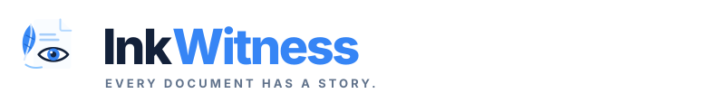
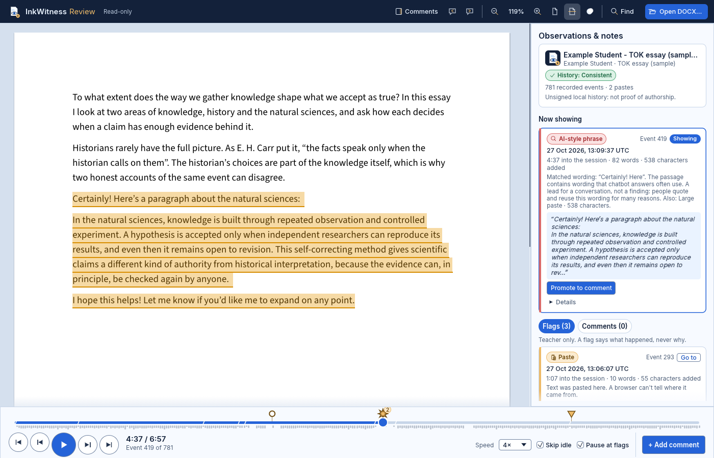

<p align="center"></p>
<p align="center"><strong>Every document has a story.</strong></p>
<p align="center"><em>Write · Replay · Understand</em></p>
<p align="center">
  <a href="https://rktrobinhood.github.io/InkWitness/review/"><strong>Open InkWitness Review</strong></a> ·
  <a href="https://rktrobinhood.github.io/InkWitness/write/">Open InkWitness Write</a> ·
  <a href="https://rktrobinhood.github.io/InkWitness/">Project home</a>
</p>

# InkWitness

**A Word-style editor that records how a document is written, and a teacher page that replays it.**

Students hand in **one ordinary `.docx`** that opens in Microsoft Word. Inside it, InkWitness keeps the history of how the document was written. Teachers open the same file on the Review page, replay the writing, look at the flagged moments and add their own comments. The file never leaves the teacher's computer: there are no accounts, no uploads and no server.

InkWitness is open source and built on [WordCraft](https://github.com/storytold/wordcraft), a Word-compatible word processor written in Rust and compiled to WebAssembly. It is being developed for a supervised IB Theory of Knowledge essay writing day.



<p align="center"><em>The sample submission, replayed to the moment a chatbot answer was pasted in.</em></p>

## Try it

1. Open [InkWitness Review](https://rktrobinhood.github.io/InkWitness/review/) and press **Try a sample submission**. The essay and the student are made up.
2. Hover the star-shaped pin on the timeline, then click it to jump to the pasted passage.
3. Press **Promote to comment**, shorten the draft and press **Save comment**.
4. Select a few words on the page, press **+ Add comment** and save.
5. Press **Download review copy (.docx)** and open the file in Word.
6. Press play to watch the essay being written from the start.

To review a real submission, press **Open DOCX…** or drop the file onto the page.

## What it does

### InkWitness Write (`/write/`), for students

- The WordCraft word processor, running entirely in the browser.
- Every committed edit is recorded. A paste is linked to the exact edit it made, not guessed from text length.
- Save writes a normal `.docx`. The writing history is stored inside it as an [Open Packaging Conventions Custom XML part](docs/DOCX_FORMAT.md), which Word and LibreOffice keep when they resave the file.

### InkWitness Review (`/review/`), for teachers

| | |
|---|---|
| **Read the document** | The submitted file is shown as pages, read-only, exactly as WordCraft lays it out. |
| **Replay the writing** | A player along the bottom: play and pause at 0.5× to 16×, skip idle time, pause at flags, step one edit or one flag at a time, or drag along the timeline. |
| **Flags** | Pins on the timeline and cards in the side rail for **Paste**, **Large paste**, **Large insertion**, **Large deletion**, **Text already there** (in the file when it was opened) and **AI-style phrase**. Each card shows when it happened, how far into the session, how much changed and the text involved. Hover a pin for details and click it to jump there. |
| **Teacher comments** | Select text on the page and add a comment. Comments appear beside the page like Word comments, and you can edit or remove them. The student's file is never changed. |
| **Highlights** | Select text and press **Highlight**, in yellow, green, blue or pink. Highlights are listed with your comments and can be removed. |
| **Promote to comment** | Turn any flag or edit into a draft comment, filled in from the record. Trim or rewrite it, then save it. |
| **Review copy** | Download a `.docx` of the essay with your comments as Word comments, your highlights as Word highlights and your edits as Word tracked changes. |
| **Toolbar or full ribbon** | A slim viewer toolbar by default. The **Full ribbon** switch shows WordCraft's ribbon as well, and the browser remembers your choice. |
| **Teacher edits** | With the full ribbon on, type your name once and edit the final document. Every change is a tracked change in your name, so Word shows who changed what. Stepping back through the history shows the student's text; your edits show again at the end. They go only into the review copy. |
| **History check** | Review replays the whole history and says whether it rebuilds the document, whether the file was changed outside InkWitness, or whether the history is damaged or missing. |

## Fair by design

- **Flags say what happened, never why.** There is no AI-detection score, no probability and no verdict. A flag is a reason to look more closely or to talk with the student.
- **AI-style phrase flags quote the exact wording,** such as "As an AI language model", so the teacher can judge it. They only look at pasted, imported or large inserted text.
- **Files stay on your computer.** Both pages are static files. There are no accounts, no uploads, no analytics, no third-party scripts and no remote AI services.
- **Students can see what is recorded.** The code is public, so there are no hidden checks. InkWitness does not log raw keystrokes, inspect other tabs, read browser extensions or fingerprint devices.
- **The history is a record, not a signature.** The history check catches accidental damage and many later edits. A student controls their own file, so a determined student could alter it. Keep the copy that was handed in.

## Current limits

- **Comments, highlights and edits live in the browser tab** until you download the review copy. Reloading the page clears them.
- **Write doesn't yet ask for the student's name, show the academic-integrity notice or save automatically.** Students should save often. These are the next stage of work (G1 below).
- **Browsers:** tested so far in desktop Chromium, the engine behind Chrome and Edge. A browser with WebGL2 is needed. Firefox, Safari and school-managed devices are not tested yet.
- **Microsoft Word:** WordCraft and LibreOffice round trips keep the history. Opening a submission or a review copy in desktop Word has not been tested yet.
- **Edits made later in Word** are not recorded. If a student keeps working in Word, the history covers only the time spent in InkWitness Write, and Review reports that the file was changed outside InkWitness.
- WordCraft is **alpha software**. Check DOCX layout and behaviour in your school's browsers before relying on it.

## Roadmap

| Stage | Scope | Status |
|---|---|---|
| **G0** | Import WordCraft, record edits, embed the history in the DOCX, replay it | Done |
| **G1** | Student name and assessment title, academic-integrity notice and first-save confirmation, autosave and crash recovery | Next |
| **G2** | Teacher review: replay player, flags, comments, review copy | Largely built; smooth scrolling during replay and keeping comments across a reload remain |
| **G3** | Cross-browser and Word testing, accessibility, privacy and hostile-file hardening | Planned |
| **V2** | School Microsoft 365 sign-in, OneDrive/SharePoint and Teams hand-in, teacher assignment designer | Future, after V1 is in classroom use |

The detailed release gates are in [`docs/PROJECT_PHASES.md`](docs/PROJECT_PHASES.md) and [`docs/BACKLOG.md`](docs/BACKLOG.md).

| | **V1 (now)** | **V2 (later)** |
|---|---|---|
| Hosting | Static GitHub Pages: `/write/` and `/review/` | School-approved Microsoft 365 workflow; the web front end can stay |
| Identity | Name and assessment title entered by the student, local attempt ID | School Microsoft Entra ID sign-in and roles |
| Drafts | Browser storage and local backups | The same, plus approved OneDrive/SharePoint sync |
| Hand-in | **One ordinary `.docx`**, submitted through the school's usual channel | Delivered through an authorized Teams/SharePoint workflow |
| Review | Teacher opens the `.docx` locally at `/review/` | Teacher inbox, plus the same replay |
| Dependencies | **No Microsoft registration, tenant permissions, database or backend** | Needs school IT approval before any work starts |

**Scope rule for contributors and coding agents:** build V1 (G0–G3) first. Do not add Microsoft sign-in, Graph, teacher dashboards, cloud buttons or backend work to V1. V2 starts only after V1 is deployed and passes its classroom-readiness gates, and it reuses V1's DOCX format and replay engine. See [`docs/V2_MICROSOFT365_ROADMAP.md`](docs/V2_MICROSOFT365_ROADMAP.md) and [`docs/V2_DISCOVERY_AND_SECURITY.md`](docs/V2_DISCOVERY_AND_SECURITY.md).

## Build and run locally

Needs Rust 1.95 with the `wasm32-unknown-unknown` target, and Trunk 0.22.1.

```sh
scripts/build-pages.sh                       # writes dist/pages/{index.html,img/,write/,review/,app/,brand/,licenses/}
python3 -m http.server -d dist/pages 8000    # then open http://127.0.0.1:8000/
```

For editor development, use upstream's dev server: `cd vendor/wordcraft/apps/wordcraft-web && trunk serve`, then open <http://127.0.0.1:8771/>.

Specification, schema and brand checks (no Rust needed):

```sh
python3 scripts/validate_starter.py
```

`.github/workflows/pages.yml` builds the site on every pull request and deploys it to GitHub Pages on every push to `main`. `.github/workflows/evidence-tests.yml` runs the recorder, DOCX and replay tests.

Coding agents start with [`AGENTS.md`](AGENTS.md) and [`docs/AGENT_PROMPT.md`](docs/AGENT_PROMPT.md). Contribution notes are in [`CONTRIBUTING.md`](CONTRIBUTING.md).

## How it works

- **Observed events:** committed editor operations, clipboard events where the browser reports them, and import and recovery boundaries. A large difference between two saved files is *not* a paste event.
- **Recording history:** checkpoints and reversible operations with stable event IDs and exact anchors, embedded in the DOCX. Replay rebuilds the document in WordCraft's own page renderer; it is not a screen recording. Review never invents missing history.
- **Flags:** computed from the recorded events by transparent rules ([`docs/DIAGNOSTICS.md`](docs/DIAGNOSTICS.md)). None of them establishes AI authorship, plagiarism or misconduct.
- **Integrity:** replaying the events and comparing the result with the document detects accidental corruption and many edits. **A hash inside a student-controlled DOCX cannot authenticate a deliberately modified file.** An independent receipt or a controlled hand-in copy is needed for that.
- **Continuing in Word:** the history survives normal Word saves when Custom XML parts are kept, but typing done later in Word is not part of the InkWitness replay. Keep the original writing-day submission.

## Repository layout

| Path | Purpose |
|---|---|
| `vendor/wordcraft/` | WordCraft v0.11.0, imported in full, with InkWitness changes listed in [`docs/UPSTREAM_LOCK.md`](docs/UPSTREAM_LOCK.md) |
| `vendor/wordcraft/crates/inkwitness/` | The recorder: events, anchors, digests and the DOCX history envelope |
| `vendor/wordcraft/crates/inkwitness-review/` | The writer hook and the Review page: replay, player, flags, comments and review copy |
| `site/` | The project home page |
| `scripts/` | Site build, WordCraft bootstrap and starter validation |
| `assets/brand/` | InkWitness logo, icons, favicons and social preview |
| `docs/SPEC.md` | Product contract and architecture |
| `docs/PROJECT_PHASES.md`, `docs/BACKLOG.md`, `docs/TEST_MATRIX.md` | Release gates, backlog with test evidence, regression tests |
| `docs/DOCX_FORMAT.md` | Standard DOCX parts, the history envelope and trust levels |
| `docs/REPLAY_UI.md`, `docs/DIAGNOSTICS.md` | Review page behaviour and flag rules |
| `docs/STORAGE_AND_RECOVERY.md` | Browser journal, checkpoints, backups and recovery |
| `docs/POLICY_AND_PRIVACY.md` | Student disclosure, academic-integrity declaration, AI-assistant notices |
| `docs/BRANDING.md` | Brand use and the upstream trademark boundary |
| `docs/G0_REPORT.md` | G0 results and evidence |
| `docs/V2_MICROSOFT365_ROADMAP.md`, `docs/V2_DISCOVERY_AND_SECURITY.md` | Future Microsoft 365 workflow and school IT decisions |
| `schemas/`, `examples/` | Versioned data contracts and synthetic examples |
| `policies/` | Public policy and AI-assistant declaration examples |

## Academic-integrity policy

The school starting reference is [Ikast-Brande Gymnasium's IB policy page](https://www.ikast-gym.dk/ib/more-about-the-ib/policies). Its **Academic Integrity** section is dated **March 2025**. Confirm the wording with the school before use. Student-facing text paraphrases the policy and links to it; it does not quote it.

For official examinations, follow school regulations, including any separately required monitoring tools. InkWitness does not replace them. A static web page cannot stop someone from modifying their own browser, cannot reliably detect AI browser extensions, and cannot guarantee that browser storage survives device loss or clearing site data.

## Security and student records

The public repository, JavaScript and WebAssembly contain **no secrets**. Never commit real student names, essays, activity records or submitted DOCX files; examples use made-up names such as "Example Student". The `/review/` address is public and is not access control, but it holds no documents: files are read in the teacher's browser. See [`docs/POLICY_AND_PRIVACY.md`](docs/POLICY_AND_PRIVACY.md) and [`docs/DOCX_FORMAT.md`](docs/DOCX_FORMAT.md).

## License and attribution

InkWitness code and documents are offered under the [MIT license](LICENSE). WordCraft is MIT OR Apache-2.0; its notices, copyright and attribution are kept in `vendor/wordcraft/` and published at [`/licenses/`](https://rktrobinhood.github.io/InkWitness/licenses/). Product names in the app are **InkWitness Write** and **InkWitness Review**; internal `urn:workalone:*` v1 wire-format identifiers stay as they are until a versioned migration. See the [brand assets preview](assets/brand/preview.html) and [`docs/BRANDING.md`](docs/BRANDING.md).

**InkWitness is independently developed on the WordCraft codebase and is not affiliated with or endorsed by the ArtCraft Team or Microsoft.**
