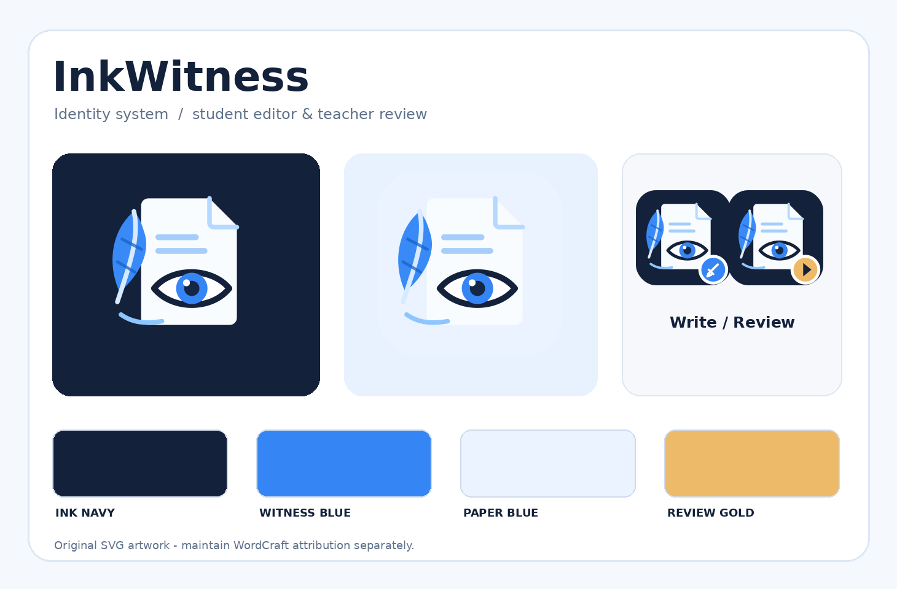

# InkWitness — identity, icons and upstream replacement contract

> **Project brand:** `InkWitness` · GitHub repository `inkwitness` · Student route `InkWitness Write` · Teacher route `InkWitness Review`.
>
> **Tagline:** **Every document has a story.**
>
> **Purpose:** open-source, local-first, Word-compatible writing and replay. The brand is **not** an anti-cheating verdict or a promise of cryptographically authenticated authorship.

## 1. Delivered assets

All original, editable master artwork lives in `assets/brand/`. **Use the committed SVGs**, not screenshots of the concept board or WordCraft's original icon.

| File | Recommended use |
|---|---|
| `inkwitness-app-dark.svg` | Primary app icon on dark background, GitHub repository/avatar if desired |
| `inkwitness-app-light.svg` | Alternative app icon for light UI |
| `inkwitness-mark.svg` | Transparent mark on cards, dialog headers and watermarks (do not mistake branding for forensic document watermark) |
| `inkwitness-mark-mono.svg` | Monochrome assets and printed documentation |
| `inkwitness-lockup.svg` | README and light UI header |
| `inkwitness-lockup-on-dark.svg` | Dark UI/header |
| `inkwitness-write.svg`, `inkwitness-review.svg` | Student and teacher route tabs/launcher cards (same core mark, small role badge) |
| `favicon.svg`, `favicon.ico` | Browser favicons |
| `png/inkwitness-16.png`, `32`, `48`, `64`, `128`, `180`, `192`, `256`, `512` | Favicon/manifest/social/OS raster sizes |
| `apple-touch-icon.png` | Mobile bookmark icon |
| `social-preview.png` | GitHub repository social preview (1280x640); upload manually in repository Settings > General if desired |
| `brand-preview.png`, `preview.html` | Visual QA and design documentation only; the HTML page is *not* a working editor |

**Colors:** Ink Navy `#13213A` (background/text); Witness Blue `#3685F5` (main action/iris); Paper Blue `#EAF3FF` (light surfaces); Review Gold `#EDBA69` (teacher playback observation, never a misconduct verdict); Slate `#60728B` (muted text). Ensure WCAG contrast for small type and keyboard focus. Avoid using color alone to label a flag.

**Typography:** use an available open/system sans-serif stack (`Inter`, `Segoe UI`, `Arial`, `sans-serif`). Do **not** add proprietary Word/Office/ArtCraft fonts. The SVG lockup uses live text; the committed PNG/social image has fixed rendering.

### Design meaning
The document represents the essay; the ink feather represents drafting; the eye represents the ability to witness how a text developed. It should feel editorial and transparent rather than punitive. Tagline: *Every document has a story.* Short product descriptor: *Write. Replay. Understand.*

## 2. What to rebrand in the real WordCraft fork

**Do not pretend this starter contains a WordCraft build.** Import and inspect the pinned upstream workspace first (`docs/UPSTREAM_PLAN.md`). The following are known entry points from upstream source inspection **as of 27 Oct 2026**; inspect the pinned tag rather than assuming `main` is unchanged:

1. **Browser HTML:** `vendor/wordcraft/apps/wordcraft-web/index.html` currently contains `<title>WordCraft</title>`, a Trunk favicon reference to `../../assets/app-icon/wordcraft.ico`, and “Loading WordCraft…”; change the InkWitness-built app shell/title/favicons to the new marks. Under Trunk, ensure asset paths are inside the package and resolve under a GitHub project-page prefix. Do not introduce externally hosted assets.
2. **UI shell:** inspect `apps/wordcraft-web/src/web.rs`, the egui top bar and menu text in `crates/ui-egui/` and related source for product identity. Where the UI presents its *application name*, use **InkWitness**; retain “Based on WordCraft” as attribution in About/Credits. Do not rename Rust public modules or commands simply to rebrand.
3. **Write/review routes:** same InkWitness core brand for both, with optional blue Write / gold Review badge. Page `<title>` should be `InkWitness Write — [assessment]` or `InkWitness Review` (escape assessment text safely). Set `document.title`, HTML `lang`, alt text and favicon consistently.
4. **Static manifest/icons:** wire `favicon.svg` and/or `favicon.ico`, `apple-touch-icon.png`, and 192/512 PNGs into the built site. A web app manifest is optional; if added, use the proper scope/start URL for `/write/` and `/review/` under project pages. Do not treat manifest installability as a project requirement.
5. **Desktop/icon packaging, only if ever distributed:** upstream native app includes `assets/app-icon/wordcraft.svg`, `packaging/icons.sh`, `apps/wordcraft/src/main.rs` referencing compiled icon paths. Reconfigure these only if building a *separately branded InkWitness desktop binary*; do not break the GitHub Pages WASM workflow to support an unrequested desktop package.
6. **Document identity:** standard Word content should say student name and assessment, not force an InkWitness commercial header or watermark. Store `generator=InkWitness` (with version) in custom metadata where relevant. Preserve/verify original model and DOCX structure.
7. **Teacher reviewer:** include app identity on top bar and report, but never overwrite the original DOCX with an edited teacher copy during review unless specifically requested.
8. **Icons vs functional UI:** replace WordCraft/ArtCraft **application branding** only (logo, browser favicon, splash, about/app title). **Do not wholesale replace standard editing-command icons** for Bold, Table, Paste, Track Changes, etc. These are functional UX assets with established meanings and their own open licenses.

### Upstream brand/legal boundary — mandatory

The upstream WordCraft GitHub repository licenses its **software** MIT OR Apache-2.0, but ArtCraft's own `docs/brand/LICENSE-brand.txt` states that **ArtCraft marks are not open-source and must be removed from modified forks**. Do not copy, recolor, crop, trace or ship these trademarked ArtCraft assets with InkWitness. Preserve WordCraft source copyright, SPDX headers, LICENSE-MIT, LICENSE-APACHE, NOTICE and any third-party `ATTRIBUTION.md` rows that remain applicable. You may describe the app in plain text as “Built on WordCraft by the ArtCraft Team”; do not suggest endorsement. Review `docs/brand/` in the imported workspace and remove trademark-restricted marks before releasing a modified version, while retaining legally required notices.

Primary upstream references:
- https://github.com/storytold/wordcraft/blob/main/docs/brand/LICENSE-brand.txt
- https://github.com/storytold/wordcraft/blob/main/apps/wordcraft-web/index.html
- https://github.com/storytold/wordcraft/blob/main/AGENTS.md
- https://github.com/storytold/wordcraft/blob/main/ATTRIBUTION.md

## 3. Visual and accessibility acceptance criteria

- Logo recognizable at 16px favicon; 32/48/192/512 raster variants present and legible.
- Both Write and Review identify themselves as InkWitness; app titles, loading, favicon, About and GitHub README have consistent branding.
- Light/dark themes, 200% zoom, high DPI, small windows and keyboard focus display correctly.
- No trademarked ArtCraft logos remain in distributable InkWitness UI or bundled marketing assets. Do not alter/source-copy Microsoft Office iconography.
- The editor's original function icons remain familiar; commands and accessibility semantics unchanged.
- Brand asset render test (SVG XML, PNG sizes, valid ICO) passes as part of starter validation; the actual WASM replacement build remains a separate integration test.

## 4. Licensing, generation and customization

Original InkWitness brand vectors and their raster derivations are created for this project and are included under the root MIT license. `assets/brand/ATTRIBUTION.md` describes derivation. The name is used as a project identifier; no trademark registration or availability clearance is represented here. You may change the brand palette/mark later by editing the SVG sources or regeneration script.

To regenerate raster assets after editing the brand master, install the optional developer packages `Pillow` and `CairoSVG`, then run `python3 scripts/generate_brand_assets.py`. This script regenerates SVG masters too: modify the generator if you want persistent artwork changes. Runtime pages do not need Python or these libraries.

**No copy of Microsoft Word, WordCraft or ArtCraft icon artwork was used to create the InkWitness symbol.**
